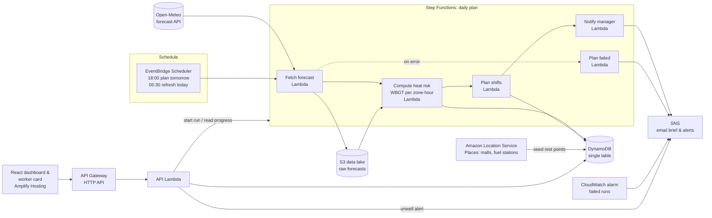

# 🌡️ HeatShift

**Heat-safe shift planning for outdoor workers. It moves the work, not the risk.**

HeatShift turns tomorrow's weather forecast into a ready-to-approve shift plan for a fleet of outdoor workers (delivery riders, construction crews, sanitation and logistics staff). For each zone and hour it estimates heat stress (WBGT). It then stops outdoor work in dangerous hours and moves shifts into cooler hours. It schedules paid rest breaks, points workers to nearby cool rest points, and holds new joiners to stricter limits. It blocks unsafe dispatches and alerts the manager the moment a worker reports feeling unwell.

Built for the WeMakeDevs × AWS **Environmental Hacks** (Heat & Water track). Runs fully serverless on AWS and is deployed with **AWS SAM**.

- **Live dashboard:** https://main.d2gge5mhbtu65h.amplifyapp.com
- **Worker card (mobile):** https://main.d2gge5mhbtu65h.amplifyapp.com/#/worker/W009?date=2026-05-28
- **API:** https://o6ryd3pe5e.execute-api.ap-south-1.amazonaws.com/fleets/demo-gurugram

> Pick **2026-05-28 (heatwave replay)** in the date selector to see the plan for the hottest humid day of the 2026 Gurugram summer, built from that day's real archived forecast.

---

## The problem

Indian cities now regularly see heat and humidity at levels where hard outdoor work becomes dangerous within an hour. Air temperature alone hides this. The danger comes from heat *plus* humidity *plus* sun, which occupational safety measures as **Wet Bulb Globe Temperature (WBGT)**. Yet delivery and field shifts are planned the same way every day. Incentives often push workers to keep going through the hottest hours, and new workers are the most at risk: most heat deaths at work happen in a worker's first days on the job.

Fleet managers have no simple, daily tool that says: *"Tomorrow, no outdoor work 11:00–16:00 in these zones. Here is the restructured roster, the break schedule, where the cool points are, and what it costs."*

## What HeatShift does

| For the fleet manager | For the worker |
|---|---|
| A plan delivered every evening (email + dashboard) for the next day, refreshed at 05:30 | A simple mobile card: today's heat-safe shift |
| Zone × hour WBGT heatmap and a map that follows the selected hour | Paid break times |
| **Stop window**: no outdoor work in Extreme hours; shifts moved to cooler hours | Nearest cool rest point with directions |
| Stricter limits for **new joiners** (< 14 days, not yet acclimatised) | Water target for the day |
| **Coverage gaps**: zones with no cool rest point within 2 km, with a suggested partner location | **Guaranteed pay** for planned hours |
| **Deliveries moved** to cooler hours, with a ready-made customer message | **I'm OK / I feel unwell**: "unwell" alerts the manager instantly |
| Water and ORS quantities per zone | Reporting unwell never affects pay or rating |
| **Dispatch check API**: blocks assigning a job into an Extreme zone-hour; overrides need a reason and are logged | |
| KPIs: risky worker-hours before → after, capacity change, cost of protection | |
| **Re-plan** button with live workflow progress | |

### Result on the heatwave replay (28 May 2026, 120 workers, 6 zones)

| | Usual shifts | HeatShift plan |
|---|---|---|
| Worker-hours in Danger or worse | **732** | **9** |
| Capacity change | | −3.5% |
| Cost of protection (paid breaks + guaranteed hours) | | ₹4,050 |

### Incentive design: why there is no heat surge pay

The obvious move, paying more for deliveries in extreme heat, rewards the most financially desperate workers for taking the most risk. HeatShift locks it off. It cannot be enabled through the API.

- **The work moves, not the people.** A stop window applies to *every* worker in the zone. Nobody can opt in.
- **Income protection.** Breaks are paid, and planned hours are guaranteed even when the plan shortens a shift.
- **Hard stop at dispatch.** The dispatch check refuses Extreme-band assignments. A manager can override only with a written reason, and every override goes to an audit log.
- **Safe to report.** The "I feel unwell" button never affects pay or rating, so people use it.
- **Demand is moved, not dropped.** Orders that fall in the stop window are moved to cooler hours, with a ready-made customer message.

### How a fleet starts using it (about 15 minutes)

1. **Zones:** the hubs or sites where workers operate. Heat risk is computed per zone.
2. **Roster CSV** exported from HR or a workforce system (see the [sample](frontend/public/sample_roster.csv)): `worker_id, name, phone, zone, shift_start, shift_end, join_date, type, language, channel`.
   - It is validated row by row (unknown zone, bad phone, bad dates, duplicate IDs). You get a report before anything is written.
   - Re-uploading updates existing workers, and every uploaded file is archived to S3.
   - **`join_date` drives the stricter new-joiner limits.**
3. **Rest points:** suggested from Amazon Location Service. The manager marks the ones they have a partnership with.
4. From then on it runs daily: **18:00 plan → manager approves → workers are notified**. At 05:30 the plan is refreshed, and the manager is alerted only if the heat got worse.

### How the plan reaches workers

Nothing reaches workers until a manager **approves** the plan. Approval builds one message per worker in their **language** (Hindi or English) on their **channel**:

| Channel | Who it's for | Delivery (production) |
|---|---|---|
| 💬 WhatsApp | Most workers | AWS End User Messaging Social: a WhatsApp template with **I'm OK / I feel unwell** quick replies |
| ✉️ SMS | Workers without WhatsApp | AWS End User Messaging SMS |
| 📞 Voice call | Feature phones, or workers who can't read | Outbound call with an Amazon Polly Hindi or English voice |
| 📱 Fleet app | Large platforms with their own rider app | Webhook to their app's push notifications |

The demo builds and shows the full outbox (**Worker messages** tab) but doesn't send it. WhatsApp templates need Meta business verification, and SMS in India needs DLT registration.

**Safety does not depend on the worker reading the message.** The dispatch check refuses Extreme-hour assignments either way. Messages explain the change; the dispatch block enforces it.

---

## Architecture



### AWS services and why each is used

| Service | Role |
|---|---|
| **AWS SAM** (open source) | The whole backend is one `template.yaml`, built and deployed with the SAM CLI |
| **AWS Step Functions** | Daily plan workflow: fetch → risk → plan → notify, with retries/backoff and a failure branch. The dashboard reads the execution history to show live progress |
| **Amazon EventBridge Scheduler** | 18:00 IST plan for tomorrow; 05:30 IST re-plan today with the freshest forecast (time-zone aware) |
| **AWS Lambda** (Python 3.12, arm64/Graviton) | WBGT heat engine, shift planner, API. Standard library + boto3 only |
| **Amazon DynamoDB** | Single table: fleet, zones, workers, rest points, hourly risk, plans, overrides, check-ins |
| **Amazon S3** | Raw forecast snapshots partitioned by `fleet=/date=`, moved to Infrequent Access after 30 days. Ready for Athena season reports |
| **Amazon API Gateway** (HTTP API) | REST API for the dashboard, worker cards and dispatch systems |
| **Amazon Location Service** (Places) | Finds real malls and fuel stations near each zone as cool rest-point candidates; drives the coverage-gap analysis |
| **Amazon SNS** | Manager's daily brief, escalation when the forecast worsens, instant "unwell" alerts, failure alerts |
| **Amazon CloudWatch** | Alarm on failed workflow runs → SNS; Lambda logs |
| **AWS Amplify Hosting** | Hosts the React dashboard and worker card |
| **AWS IAM** | Least-privilege per-function policies via SAM policy templates |

### Data model (DynamoDB single table)

`pk = FLEET#<id>` and `sk` is one of:

- `META`: the fleet and its policy
- `ZONE#<id>`, `WORKER#<id>`, `REST#<id>`: zones, roster and rest points
- `RISK#<date>#<zone>`: hourly WBGT and risk band per zone
- `PLAN#<date>`: KPIs, actions and worker cards
- `OUTBOX#<date>`: per-worker messages released on approval
- `OVERRIDE#<date>#<ts>`: the manager override audit log
- `CHECKIN#<date>#<ts>#<worker>`: worker check-ins

---

## How heat risk is computed

1. **Forecast:** hourly air temperature, relative humidity, wet-bulb temperature, shortwave radiation and wind from Open-Meteo for each zone. Past dates use Open-Meteo's archived *forecasts*, so a replay shows what the system would really have known the evening before.
2. **WBGT estimate (outdoor):** `WBGT = 0.7·Tw + 0.2·Tg + 0.1·Ta`
   - `Tw` is the wet-bulb temperature (from the forecast; falls back to the Stull 2011 formula).
   - `Tg` is the globe temperature, estimated from solar radiation with Hunter & Minyard: `Tg = 0.01498·SR + 1.184·Ta − 0.0789·RH − 2.739`.
3. **Risk levels:** based on the ACGIH work/rest guidance for moderate work.

| Level | WBGT (°C) | Rest per hour |
|---|---|---|
| Safe | < 28 | normal work |
| Caution | 28 | 15 min |
| Danger | 29 | 30 min |
| Severe | 30 | 45 min |
| Extreme | ≥ 31.5 | **no outdoor work** |

   New joiners (< 14 days) get thresholds **2.5 °C lower**.
4. **Planning:** shifts that overlap stop hours are rebuilt from the cooler hours of the operating window, preferring hours that need the least rest and are closest to the original shift. Breaks are scheduled per hour by risk level, and water is planned at 0.5–1 L per hour by risk level.

> WBGT here is a screening estimate from forecast data, not a measurement and not medical advice. A production deployment should calibrate against on-site WBGT meters and follow local regulation.

---

## API

| Method | Path | Purpose |
|---|---|---|
| GET | `/fleets/{id}` | Fleet, policy, zones, workers, rest points, list of plans |
| GET | `/fleets/{id}/plans/{date}` | Plan with hourly risk, overrides and check-ins |
| POST | `/fleets/{id}/plans` | Start a planning run (`{"date": "YYYY-MM-DD"}` optional) |
| GET | `/fleets/{id}/runs/{run}` | Live progress of a run (per-step state) |
| POST | `/fleets/{id}/plans/{date}/approve` | Manager approves the plan; builds the worker outbox and emails a summary |
| POST | `/fleets/{id}/roster` | Import a roster CSV (`{"csv": "...", "dry_run": true}` validates only) |
| GET | `/fleets/{id}/workers/{wid}/card?date=` | Worker card |
| GET | `/fleets/{id}/dispatch-check?zone=&at=&worker=` | Is this assignment allowed? |
| POST | `/fleets/{id}/overrides` | Log a manager override (reason required) |
| POST | `/fleets/{id}/checkins` | Worker check-in (`ok` / `unwell`). Unwell sends an SNS alert |
| PUT | `/fleets/{id}/policy` | Update policy (heat surge pay stays locked off) |

Example:

```bash
curl "https://o6ryd3pe5e.execute-api.ap-south-1.amazonaws.com/fleets/demo-gurugram/dispatch-check?zone=Z1&at=2026-05-28T13:30"
# {"allowed": false, "band": "EXTREME", "wbgt": 33.2, "reason": "EXTREME heat stress (WBGT 33.2°C): no outdoor work in this window", ...}
```

---

## Run it yourself

Prerequisites: an AWS account, AWS CLI, AWS SAM CLI, Python 3.12, Node 20+, and an Amplify Hosting app with a `main` branch for the frontend.

```bash
# 1. Backend
sam build
sam deploy --guided --stack-name heatshift --capabilities CAPABILITY_IAM \
  --parameter-overrides AlertEmail=you@example.com AppUrl=https://<your-amplify-url>
# confirm the SNS subscription email

# 2. Seed the demo fleet (zones, synthetic roster, rest points from Amazon Location Service)
uv run --with boto3 python scripts/seed.py <TableName from stack outputs>

# 3. Generate plans
aws stepfunctions start-execution --state-machine-arn <StateMachineArn> \
  --input '{"fleet_id": "demo-gurugram", "date": "2026-05-28"}'

# 4. Frontend
echo "VITE_API_URL=<ApiUrl>" > frontend/.env.production
cd frontend && npm install && cd ..
AMPLIFY_APP_ID=<your app id> scripts/deploy_web.sh
```

## Repository layout

```
template.yaml              SAM: all infrastructure
backend/src/heatshift/     heat.py (WBGT, risk levels), planner.py, weather.py, store.py, demo.py
backend/src/handlers/      pipeline.py (Step Functions steps), api.py (HTTP API)
frontend/                  React + Vite + Leaflet dashboard and worker card
scripts/                   seed.py, deploy_web.sh
```

## Data sources

- **Weather:** [Open-Meteo](https://open-meteo.com/), forecast and historical-forecast APIs (CC BY 4.0).
- **Places:** Amazon Location Service Places API.
- **Map tiles:** © OpenStreetMap contributors.
- **Workers:** the 120-person roster and the hub are **synthetic** demo data.

## Known limitations

- Restructured shifts use the same cool-hours template (early morning + evening). There is no per-hour staffing cap yet, so demand peaks are not balanced.
- Rest-point distance is measured from the zone centre, not each worker's live location.
- WBGT is estimated from forecasts. Shade, clothing and workload are assumed (moderate work, outdoors, in the sun).
- The demo has no authentication. A production version would use Amazon Cognito for managers and signed links for worker cards.

## Roadmap to production

- **Cognito** sign-in for managers. Multiple fleets per account.
- **WhatsApp/SMS worker cards** via AWS End User Messaging, in local languages.
- **IMD heatwave warnings** merged into the risk model; on-site WBGT sensors through AWS IoT Core for calibration.
- **Athena + Glue** season reports over the S3 data lake: exposure hours avoided, overrides, unwell reports per zone.
- **Dispatch integrations:** call the dispatch check from existing routing systems before assigning a job.
- **Staffing-aware planning:** cap workers per hour and balance shifts against demand forecasts.

## Team

Built during WeMakeDevs × AWS Environmental Hacks (Oct 2026).
